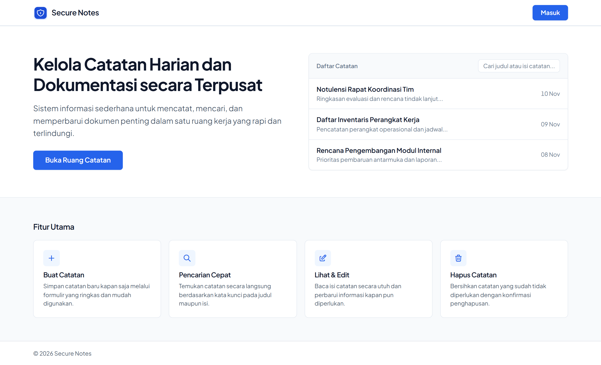
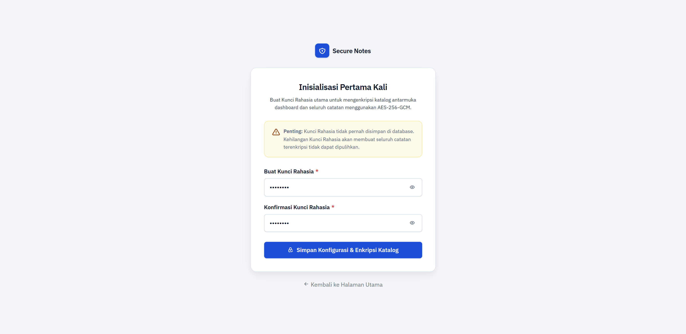
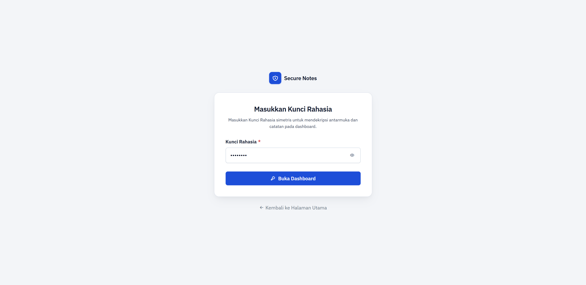
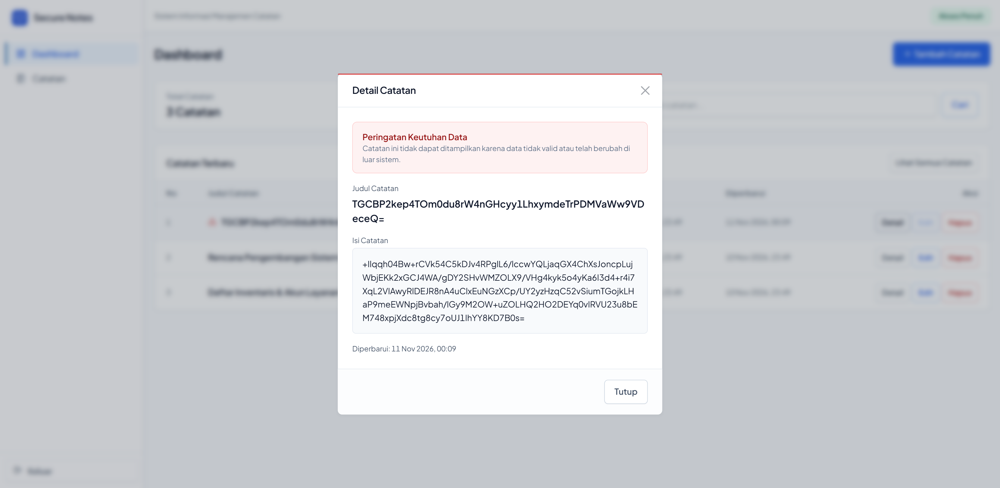
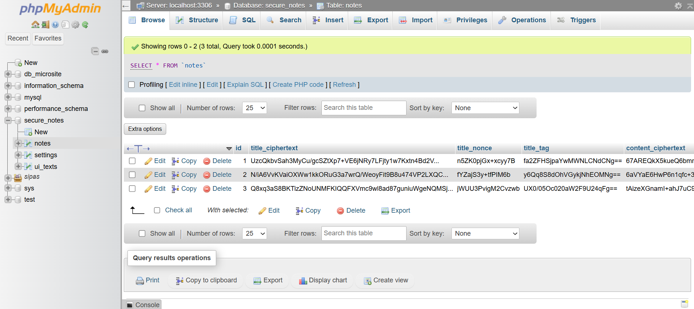

<p align="center">
  
</p>

<h1 align="center">SecureNotes</h1>

<p align="center">
  Aplikasi manajemen catatan terenkripsi berbasis AES-256-GCM & PBKDF2-HMAC-SHA256.
</p>

<p align="center">
  
  
  
  
  
  
  
</p>

<p align="center">
  SecureNotes adalah aplikasi brankas catatan terenkripsi yang menerapkan verifikasi integritas data bawaan (authenticated encryption) untuk melindungi kerahasiaan catatan serta mendeteksi setiap modifikasi data di tingkat basis data.
</p>

---

## Disusun Oleh

<table>
  <tbody>
    <tr>
      <td><strong>Nama</strong></td>
      <td><strong>MUHAMAD DIKRULLOH</strong></td>
    </tr>
    <tr>
      <td><strong>NIM</strong></td>
      <td><strong>2430511076</strong></td>
    </tr>
    <tr>
      <td><strong>Kelas</strong></td>
      <td><strong>5B</strong></td>
    </tr>
    <tr>
      <td><strong>Mata Kuliah</strong></td>
      <td>Keamanan Data dan Informasi</td>
    </tr>
  </tbody>
</table>

---

## Fitur Utama

- **Enkripsi AES-256-GCM Penuh:** Seluruh teks UI (`ui_texts`) serta judul dan isi catatan (`notes`) disimpan dalam bentuk ciphertext Base64 dengan Nonce 12-byte unik dan Tag autentikasi 16-byte.
- **Dua Mode Tampilan:**
  - **Mode Terbuka:** Kunci lolos verifikasi, seluruh teks didekripsi, operasi CRUD aktif.
  - **Mode Terkunci:** Kunci salah/ditolak, tampilan tetap utuh namun seluruh konten berupa ciphertext asli dan penulisan data ditolak (`HTTP 403`).
- **Deteksi Integritas (Anti-Tamper):** Jika ciphertext, nonce, atau tag di database diubah paksa, verifikasi tag GCM gagal, sistem menampilkan peringatan manipulasi dan mengunci edit.

---

## Struktur Proyek

```text
SecureNotes/
├── assets/
│   ├── app.css              # Desain sistem & tata letak antarmuka
│   ├── app.js               # Handler modal CRUD & toggle keamanan
│   ├── logo.svg             # Logo visual identitas aplikasi
│   └── screenshots/         # Dokumentasi tangkapan layar antarmuka
├── includes/
│   ├── app.php              # Helper sesi aman, CSRF, proteksi UI, & DB
│   ├── crypto.php           # Implementasi PBKDF2 & AES-256-GCM
│   └── notes_table.php      # Komponen tabel catatan
├── .htaccess                # Proteksi akses file konfigurasi
├── auth.php                 # Halaman input Kunci Rahasia
├── config.php               # Konfigurasi koneksi database & KDF
├── dashboard.php            # Antarmuka dashboard & endpoint CRUD
├── index.php                # Landing page publik
├── logout.php               # Pembersihan sesi dan kunci aman
├── secure_notes.sql         # Skema tabel MySQL siap pakai
└── setup.php                # Inisialisasi Kunci Rahasia pertama kali
```

---

## Panduan Singkat Instalasi

1. **Letakkan Proyek:** Simpan di `C:\laragon\www\SecureNotes`.
2. **Jalankan Laragon:** Klik **Start All** (Apache & MySQL).
3. **Impor Database:** Jalankan di terminal Laragon:
   ```bash
   mysql -u root < secure_notes.sql
   ```
4. **Buka Aplikasi:** Akses `http://localhost/SecureNotes/` dan selesaikan **Inisialisasi Sistem** (`setup.php`) dengan membuat Kunci Rahasia (minimal 8 karakter).
5. **Reset Database (Opsional):** Jika ingin mengulang setup:
   ```bash
   mysql -u root -e "TRUNCATE TABLE secure_notes.settings; TRUNCATE TABLE secure_notes.ui_texts; TRUNCATE TABLE secure_notes.notes;"
   ```

---

## Alur Kriptografi

1. **KDF (PBKDF2-HMAC-SHA256):** Menghasilkan kunci biner 32-byte dari Kunci Rahasia + Salt (16-byte) dengan 600.000 iterasi.
2. **Verifikasi:** Kunci turunan menguji dekripsi data acak verifikasi di tabel `settings`. Jika tag GCM valid, kunci disimpan sementara di sesi server (`$_SESSION`).
3. **Enkripsi:** `openssl_encrypt($plaintext, 'aes-256-gcm', $key, OPENSSL_RAW_DATA, $nonce, $tag, '', 16)` dengan Nonce 12-byte acak per item.
4. **Dekripsi:** `openssl_decrypt(...)` memverifikasi integritas tag 16-byte. Jika tidak cocok, dekripsi gagal (`null`) dan data ditandai sebagai rusak/dimodifikasi.

---

## Tangkapan Layar

<table width="100%">
  <tr>
    <td width="50%" align="center">
      <strong>1. Halaman Utama (Landing Page)</strong><br>
      
    </td>
    <td width="50%" align="center">
      <strong>2. Inisialisasi Sistem (Setup)</strong><br>
      
    </td>
  </tr>
  <tr>
    <td width="50%" align="center">
      <strong>3. Otentikasi Kunci Rahasia</strong><br>
      
    </td>
    <td width="50%" align="center">
      <strong>4. Dashboard Terbuka (Kunci Valid)</strong><br>
      
    </td>
  </tr>
  <tr>
    <td width="50%" align="center">
      <strong>5. Dashboard Terkunci (Ciphertext)</strong><br>
      
    </td>
    <td width="50%" align="center">
      <strong>6. Kelola & Edit Catatan</strong><br>
      
    </td>
  </tr>
  <tr>
    <td width="50%" align="center">
      <strong>7. Deteksi Manipulasi Data (Anti-Tamper)</strong><br>
      
    </td>
    <td width="50%" align="center">
      <strong>8. Ciphertext di Database MySQL</strong><br>
      
    </td>
  </tr>
</table>
